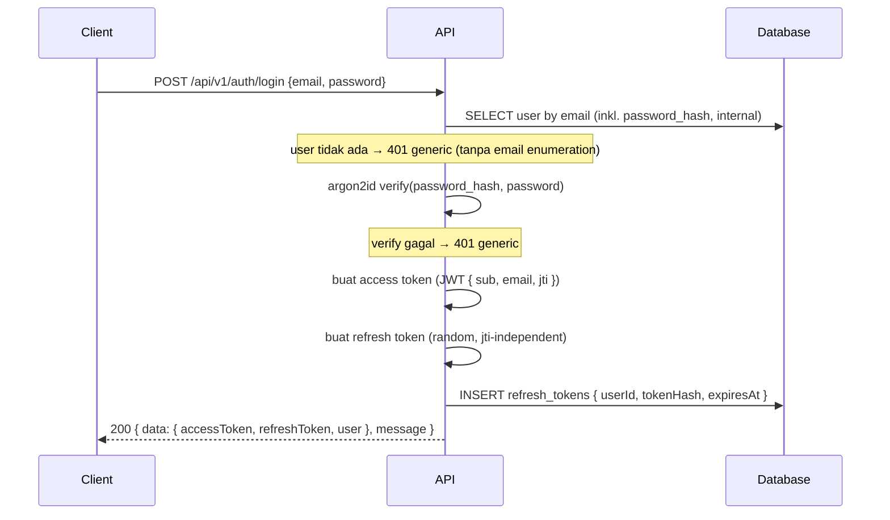
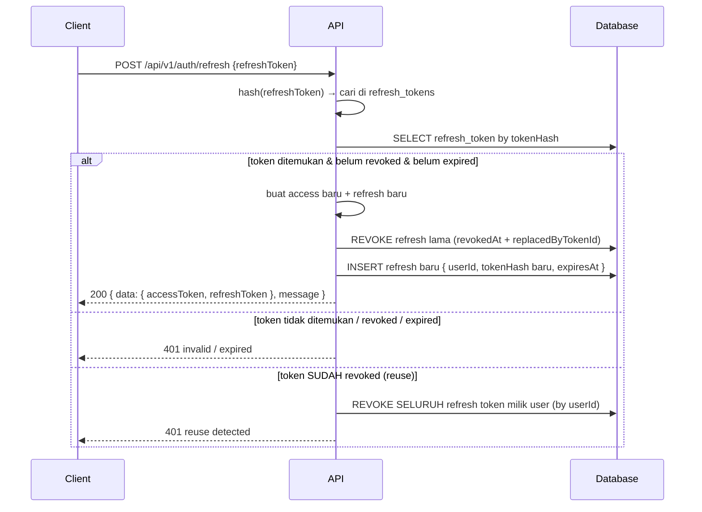
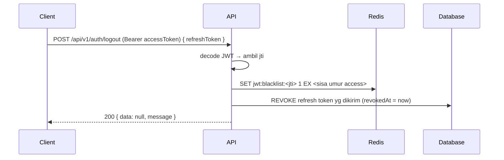
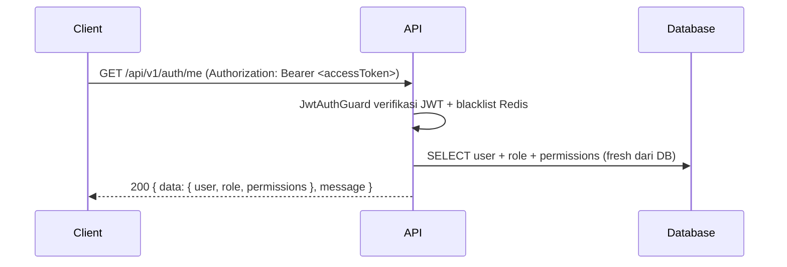

# Auth — Spec Mekanisme Autentikasi

Menu: [rbac.md](./rbac.md) (master) · [user.md](./user.md) · [role.md](./role.md) · [permission.md](./permission.md) · [role-permissions.md](./role-permissions.md) · [Compression](../RULES.md#22-compression)

---

## 1. Overview & Scope

Modul `auth` (di `libs/src/core/auth/`) menyediakan **autentikasi** — verifikasi identitas user:

- **Registrasi** via `POST /api/v1/auth/register`.
- **Login** via `POST /api/v1/auth/login` → pertukaran token (access + refresh).
- **Rotasi refresh token** via `POST /api/v1/auth/refresh`.
- **Logout** (blacklist access token + revoke refresh token) via `POST /api/v1/auth/logout`.
- **Profile** via `GET /api/v1/auth/me`.

> **Otorisasi** (role & permission) **bukan** lingkup spec ini — lihat [rbac.md §1](./rbac.md#1-overview) dan [rbac.md §6 Authorization](./rbac.md#6-authorization). Guard `PermissionsGuard` dan decorator `@Permissions(...)` hanya di-rujuk; detail implementasinya ada di rbac.md.

### Lokasi kode

```
libs/src/core/auth/
├── strategies/
│   └── jwt.strategy.ts          ← JwtStrategy
├── guards/
│   ├── jwt-auth.guard.ts        ← JwtAuthGuard (global, LOGIN)
│   ├── refresh-token.guard.ts   ← RefreshTokenGuard
│   └── permissions.guard.ts     ← PermissionsGuard (rujuk rbac.md §6)
├── auth.service.ts
├── auth.module.ts
└── dto/
    ├── login.dto.ts
    ├── refresh-token.dto.ts
    └── logout.dto.ts
```

Auth = infrastruktur internal → folder `core/` sesuai RULES bab 2 (`core/` berisi infrastruktur inti).

### Lingkup iterasi ini

| Kemampuan | Ada di iterasi ini |
| --- | --- |
| Access token JWT (HS256) | ✅ |
| Refresh token opaque + rotasi | ✅ |
| Logout + blacklist Redis | ✅ |
| `GET /api/v1/auth/me` | ✅ |
| Otorisasi permission | ❌ (ada di rbac.md) |

> Konsistensi: rbac.md §5 mencatat refresh token "opsional / belum termasuk". Spec ini **melanjutkan** keputusan tersebut — menambahkan rotasi refresh token, logout blacklist, dan `/auth/me` sebagai ekstensi yang konsisten dengan kontrak response rbac.md §8 / user.md §7.

---

## 2. Skema Token

Auth memakai **dual token**: access token (stateless, JWT) + refresh token (stateful, hashed di DB).

### Access Token (JWT)

- Algoritma **HS256**, short-lived (`JWT_EXPIRES_IN`, mis. `15m`).
- Payload: `{ sub: userId, email, jti }` — sign pakai `JWT_SECRET`.
- `jti` unik (uuid) **per token** — dipakai untuk blacklist saat logout (seksi 6).
- Stateless; verifikasi cukup membaca header + secret.

### Refresh Token

- Opaque random string (crypto-strong, mis. 32+ byte via `randomBytes`/`randomUUID`).
- **Tidak pernah disimpan plaintext** — hanya hash-nya di tabel `refresh_tokens` (seksi 5).
- Expiry `JWT_REFRESH_EXPIRES_IN` (mis. `7d`).
- Satu user boleh punya **banyak** refresh token (multi-device) — tiap device punya token sendiri.

### Ringkasan

| Jenis | Bentuk | Expiry | Penyimpanan | Secret |
| --- | --- | --- | --- | --- |
| Access | JWT HS256 (`{ sub, email, jti }`) | `JWT_EXPIRES_IN` (mis. `15m`) | Stateless (di token) | `JWT_SECRET` |
| Refresh | Opaque random string | `JWT_REFRESH_EXPIRES_IN` (mis. `7d`) | HASHED di DB (`refresh_tokens.token_hash`) | — (nir-secret; diverifikasi via hash) |

---

## 3. Password Hashing

- Algoritma **argon2id** (mis. `@node-rs/argon2`), opsi `memoryCost`, `timeCost`, `parallelism` dari env `ARGON2_*` (seksi 9).
- **Register**: password di-hash sebelum insert ke kolom `users.password_hash`.
- **Verify**: saat login, `argon2.verify(user.passwordHash, plaintext)`.
- `passwordHash` **tidak pernah** di-log, tidak masuk response, dan **tidak pernah** disertakan dalam `select` entity publik (rujuk [user.md §3](./user.md#3-entity-payload-type)).

```typescript
// pola (detail ada di user.service.ts — user.md §6)
import * as argon2 from '@node-rs/argon2';

const passwordHash = await argon2.hash(dto.password, {
  algorithm: 2, // argon2id
  memoryCost: config.get('ARGON2_MEMORY_COST'),
  timeCost: config.get('ARGON2_TIME_COST'),
  parallelism: config.get('ARGON2_PARALLELISM'),
});

const valid = await argon2.verify(storedHash, dto.password);
```

---

## 4. Flows

### Login



### Refresh (Rotasi)



### Reuse Detection

- Refresh token yang **sudah revoked/replaced** lalu dipakai lagi = sinyal token dicuri.
- Tindakan: revoke **seluruh family** — semua refresh token milik user itu di-set `revokedAt` (query `by userId`, index seksi 5), lalu kembalikan **401**.
- Penyimpanan `replacedByTokenId` pada token lama → pointer ke token pengganti, dipakai melacak rantai family (`new id → old.replacedByTokenId`) untuk forensik/audit.

### Logout



### Me



---

## 5. Data Model Prisma

Lokasi sumber: `libs/prisma/schema.prisma` (satu-satunya sumber entity — RULES bab 4).

```prisma
model RefreshToken {
  id                String    @id @default(uuid())
  userId            String    @map("user_id")
  user              User      @relation(fields: [userId], references: [id], onDelete: Cascade)
  tokenHash         String    @map("token_hash")
  expiresAt         DateTime  @map("expires_at")
  revokedAt         DateTime? @map("revoked_at")
  replacedByTokenId String?   @map("replaced_by_token_id")
  createdAt         DateTime  @default(now()) @map("created_at")
  @@index([userId])
  @@map("refresh_tokens")
}
```

Catatan konsistensi relasi:

- Model **`User`** (user.md §2 / rbac.md §3) perlu ditambahkan relation backfield saat implementasi:

```prisma
model User {
  // ... field existing
  refreshTokens RefreshToken[]
  // ... @@map("users") existing
}
```

- **Tidak menyimpan refresh token plaintext di DB** — hanya `tokenHash` (hash dari token random).
- Index `userId` (`@@index([userId])`) mendukung family revocation (seksi 4) tanpa scan penuh tabel.
- `onDelete: Cascade` pada relasi → user dihapus, semua refresh token-nya ikut terhapus.

---

## 6. Redis Usage (RULES bab 17)

### Blacklist access token

| Aspek | Nilai |
| --- | --- |
| Key | `jwt:blacklist:<jti>` |
| Value | `1` |
| TTL | **sisa umur access token** (dihitung dari `exp` JWT − `now`) |
| Set saat | logout (seksi 4) |
| Cek saat | validasi JWT di `JwtAuthGuard` |
| Key ada → | **401 Unauthorized** |

### Cache permission (opsional)

- Key `perm:user:<id>`, value `string[]` (`permission.code`), TTL eksplisit — detail di [rbac.md §6 Authorization](./rbac.md#6-authorization). Dipakai `PermissionService.getPermissionCodesByUserId`.

### Redis down / error

- Error Redis → **fallback**: `JwtAuthGuard` tetap berjalan **tanpa** cek blacklist (blacklist bersifat *only-enhancement*), jangan crash request (RULES bab 17: error Redis diabaikan, fallback).
- Catatan: access token yang sudah di-logout masih valid sampai expiry alami (jendela keamanan singkat ≤ `JWT_EXPIRES_IN`). Trade-off diterima untuk ketersediaan.

---

## 7. Endpoint

Semua path memakai prefix **`/api/v1`** (RULES bab 12). Sukses `{ data, message }`, error `{ statusCode, message, errors }` (RULES bab 5).

### Ringkasan

| Method | Path | Akses | Response | Error |
| --- | --- | --- | --- | --- |
| POST | `/api/v1/auth/register` | PUBLIC | 201 data user (tanpa password_hash) | 409 duplikat, 422 |
| POST | `/api/v1/auth/login` | PUBLIC | 200 `{ data: { accessToken, refreshToken, user } }` | 401 credential salah, 422 |
| POST | `/api/v1/auth/refresh` | PUBLIC (body `refreshToken`) | 200 `{ data: { accessToken, refreshToken } }` | 401 invalid/expired/reuse, 422 |
| POST | `/api/v1/auth/logout` | LOGIN (Bearer) + body `{ refreshToken }` | 200 `{ data: null, message }` | 401 |
| GET | `/api/v1/auth/me` | LOGIN | 200 data user+role+permissions | 401 |

### Detail per endpoint

#### POST /api/v1/auth/register

| Item | Nilai |
| --- | --- |
| Request body | `{ email, fullName, password }` (RegisterUserDto — user.md §4; trim + `@MaxLength(255/100/128)`) |
| Response 201 | `{ data: <user tanpa password_hash>, message: 'success' }` |
| Validasi | email valid, fullName string, password min 8 → gagal = 422 `{ field, message }` per-field |
| Error 409 | email duplikat (`ConflictException`, P2002) |
| Error 422 | validasi DTO (`UnprocessableEntityException`) |

#### POST /api/v1/auth/login

| Item | Nilai |
| --- | --- |
| Request body | `{ email, password }` (LoginDto) |
| Response 200 | `{ data: { accessToken, refreshToken, user }, message: 'success' }` |
| Error 401 | email tak ada / password salah → selalu **401 generic** `'Invalid credentials'` (hindari user enumeration) |
| Error 422 | validasi DTO |
| Catatan | `user.status === 'BLOCKED'` / `INACTIVE` → tolak login (401) |

#### POST /api/v1/auth/refresh

| Item | Nilai |
| --- | --- |
| Request body | `{ refreshToken }` (RefreshTokenDto) |
| Response 200 | `{ data: { accessToken, refreshToken }, message: 'success' }` (rotasi: token lama revoked, token baru terbit) |
| Error 401 | token invalid / expired / reuse detected (revoke seluruh family) |
| Error 422 | validasi DTO |

#### POST /api/v1/auth/logout

| Item | Nilai |
| --- | --- |
| Request | `Authorization: Bearer <accessToken>` + body `{ refreshToken }` (LogoutDto) |
| Response 200 | `{ data: null, message: 'success' }` |
| Aksi | blacklist `jwt:blacklist:<jti>` (TTL sisa umur access) + revoke refresh token yg dikirim |
| Error 401 | JWT invalid/expired/blacklisted |

#### GET /api/v1/auth/me

**Response 200 (WAJIB):**

```json
{
  "data": {
    "id": "9b1deb4d-3b7d-4bad-9bdd-2b0d7b3dcb6d",
    "email": "user@example.com",
    "fullName": "John Doe",
    "status": "ACTIVE",
    "role": { "id": "r_xxx", "name": "admin" },
    "permissions": ["user:read", "role:read", "permission:read"]
  },
  "message": "success"
}
```

| Item | Nilai |
| --- | --- |
| Response 200 | `{ data: { id, email, fullName, status, role, permissions }, message }` |
| Error 401 | JWT invalid/expired/blacklisted |

- `permissions` = array **`permission.code`** milik user, di-resolve **fresh dari DB** (user → `role_id` → `role_permissions` → `permission.code`), via **service yang sama** dipakai `PermissionsGuard`: `PermissionService.getPermissionCodesByUserId(userId)` (rbac.md §6).
- Role null → `"role": null`, `"permissions": []`.
- **Tanpa `password_hash`** — mengikuti pola `userSelect` (user.md §3).

---

## 8. Guards & Strategy

### Komponen

| Komponen | Peran |
| --- | --- |
| `JwtStrategy` | Passport `JwtStrategy`; baca header `Authorization: Bearer <token>`, verifikasi `JWT_SECRET`, ekstrak `{ sub, email, jti }`. |
| `JwtAuthGuard` | **Global** (LEVEL `LOGIN`). Verifikasi JWT + cek blacklist Redis `jwt:blacklist:<jti>`. Gagal → **401**. Dipakai semua endpoint kecuali yang ber-`@Public()`. |
| `RefreshTokenGuard` | Verifikasi refresh token (hash → lookup DB, cek revoked/expired, deteksi reuse). Gagal → **401**. |
| `PermissionsGuard` | Otorisasi permission; rujuk [rbac.md §6](./rbac.md#6-authorization). Kurang permission → **403**. |
| `@Permissions('user:read')` | Decorator metadata permission; rujuk rbac.md §6. |
| `@Public()` | Bypass global `JwtAuthGuard` — dipakai endpoint `register` & `login` (dan `refresh`). |

### Urutan pengecekan

```
Logika:
  JWT/refresh invalid · expired · blacklisted · reuse    → 401
  JWT valid tapi permission kurang                        → 403
```

- 401 selalu didahulukan sebelum 403.
- Login: informasi **tidak membedakan** "email tidak ada" vs "password salah" → selalu 401 generic, mencegah *user enumeration*.

---

## 9. Config & Error

### Config env (RULES bab 8)

Semua variabel divalidasi saat startup (Joi/class-validator), dibaca via `ConfigModule`/`ConfigService` — **larang** `process.env` tersebar.

| Variabel | Wajib | Default (mis.) | Keterangan |
| --- | --- | --- | --- |
| `JWT_SECRET` | ✅ | — | Secret sign access token (HS256); tidak di-commit, tidak di-log. |
| `JWT_EXPIRES_IN` | ✅ | `15m` | Umur access token. |
| `JWT_REFRESH_EXPIRES_IN` | ✅ | `7d` | Umur refresh token. |
| `JWT_REFRESH_SECRET` | ❌ | — | Opsional bila refresh juga JWS. Karena refresh = **opaque random**, cukup `JWT_REFRESH_EXPIRES_IN` — secret ini tidak diperlukan. |
| `ARGON2_MEMORY_COST` | ✅ | `65536` (64 MiB) | Opsi argon2id. |
| `ARGON2_TIME_COST` | ✅ | `3` | Opsi argon2id. |
| `ARGON2_PARALLELISM` | ✅ | `4` | Opsi argon2id. |

> Secret dijamin ada (`JWT_SECRET` reqired) — startup gagal bila kosong (validasi env, RULES bab 8).

### Tabel error

Format error standar: `{ statusCode, message, errors }` (RULES bab 5). `errors` berisi detail per-field saat 422, `[]` untuk error umum.

| Status | Konteks Auth | Penyebab |
| --- | --- | --- |
| 400 | Bad Request | body/query tidak dapat dipahami, payload tidak sesuai |
| 401 | Unauthorized | email tak ada / password salah; JWT invalid/expired/blacklisted; refresh invalid/expired; reuse detected |
| 403 | Forbidden | JWT valid tapi permission kurang (rbac.md) |
| 404 | Not Found | resource auth (user/refresh token) tidak ditemukan |
| 409 | Conflict | email duplikat saat register (P2002) |
| 422 | Unprocessable Entity | validasi DTO gagal (ValidationPipe, RULES bab 7) |
| 500 | Internal Server Error | error tak terduga |

```json
// error validasi 422
{
  "statusCode": 422,
  "message": "Validation failed",
  "errors": [{ "field": "password", "message": "password must be longer than or equal to 8 characters" }]
}

// error umum 401
{ "statusCode": 401, "message": "Invalid credentials", "errors": [] }
```

---

## 10. Compression

Semua response auth (register, login, refresh, logout, me) di-compress menggunakan **gzip** via Express `compression` middleware.

| Aspek | Nilai |
| --- | --- |
| Level | Transport |
| Implementation | `compression()` middleware (otomatis pilih gzip/deflate/br berdasarkan `Accept-Encoding`) |
| Placement | `main.ts` baris pertama setelah `NestFactory.create` |
| Benefit | Payload lebih kecil, transfer lebih cepat |

Detail lihat [RULES.md §22](../RULES.md#22-compression).