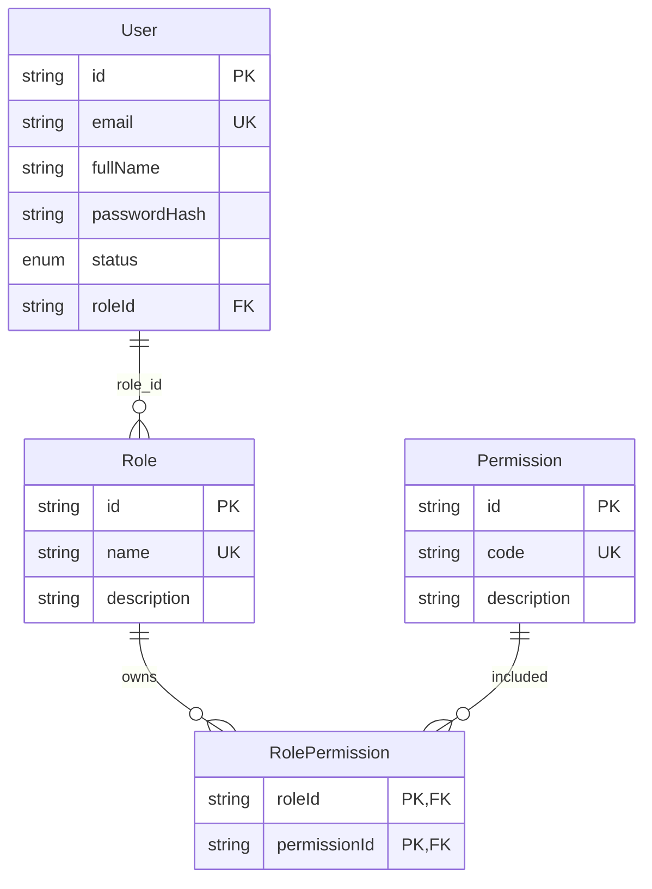
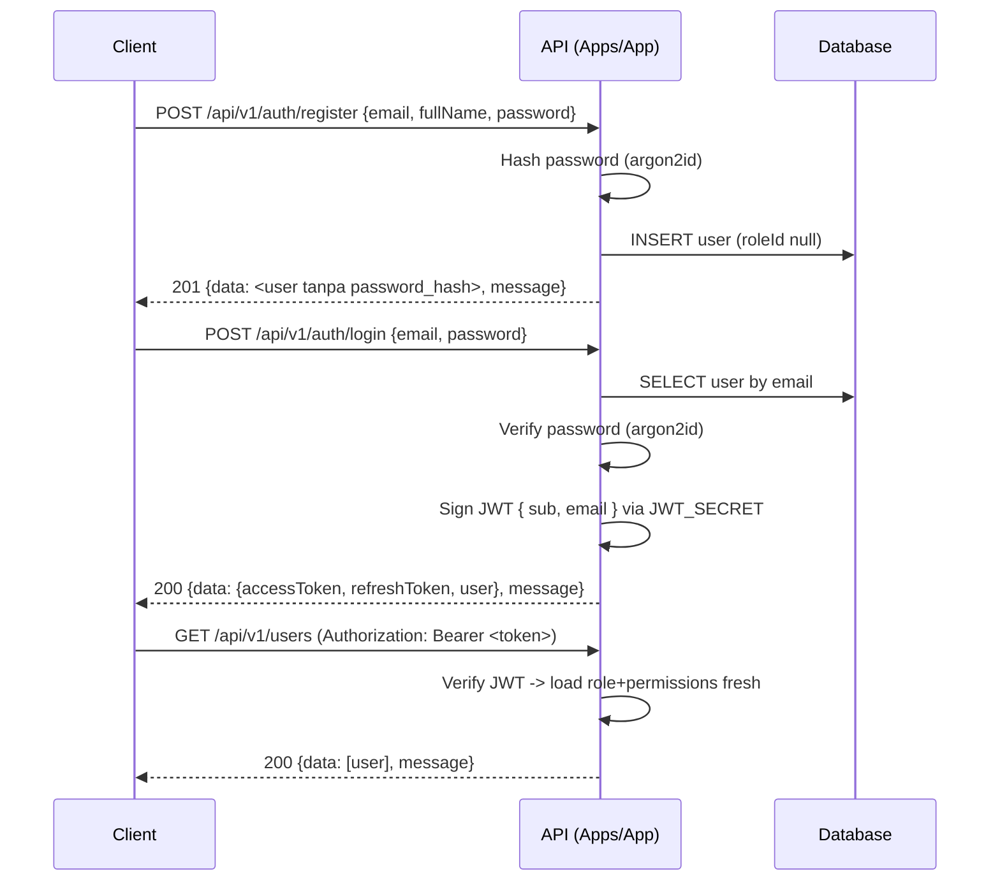

# RBAC — Role Based Access Control (Spec)

Menu: [user.md](./user.md) · [role.md](./role.md) · [permission.md](./permission.md) · [role-permissions.md](./role-permissions.md)

---

## 1. Overview

Modul RBAC menyediakan dua kemampuan inti backend:

1. **Autentikasi (Auth)** — registrasi & login user, menerbitkan JWT.
2. **Otorisasi (Authorization)** — pembatasan akses endpoint berdasarkan role dan permission user.

Model domain (final, sudah dikonfirmasi user):

| Relasi | Keterangan |
| --- | --- |
| `user` 1 : N `role` | Satu user memiliki max satu role (FK `role_id` di `users`). |
| `role` N : M `permission` | Melalui tabel join `role_permissions`. |
| `permission` | Memiliki `code` unik berkonvensi `resource:action`. |

Prinsip:

- Satu user → satu role → banyak permission.
- Akses ditentukan oleh `permission.code` (`resource:action`) yang cocok dengan dekorator endpoint.
- Sumber kebenaran tunggal (single source of truth): role/permission selalu di-load **fresh dari DB** setiap request (lihat [Authorization](#6-authorization)).

---

## 2. ERD



Versi teks:

```
User 1 ── N Role  N ── M Permission
 │                 │
 │ role_id         └── Tabel join: role_permissions (role_id, permission_id)
```

---

## 3. Model Prisma (lengkap)

Lokasi sumber: `libs/prisma/schema.prisma` (satu-satunya sumber entity, lihat RULES bab 4).

```prisma
model User {
  id           String     @id @default(uuid())
  email        String     @unique
  fullName     String     @map("full_name")
  passwordHash String     @map("password_hash")
  status       UserStatus @default(ACTIVE)
  roleId       String?    @map("role_id")
  role         Role?      @relation(fields: [roleId], references: [id])
  createdAt    DateTime   @default(now()) @map("created_at")
  updatedAt    DateTime   @updatedAt @map("updated_at")

  @@map("users")
}

enum UserStatus {
  ACTIVE
  INACTIVE
  BLOCKED
}

model Role {
  id          String           @id @default(uuid())
  name        String           @unique
  description String?
  permissions RolePermission[]
  users       User[]
  createdAt   DateTime         @default(now()) @map("created_at")
  updatedAt   DateTime         @updatedAt @map("updated_at")

  @@map("roles")
}

model Permission {
  id          String           @id @default(uuid())
  code        String           @unique
  description String?
  roles       RolePermission[]
  createdAt   DateTime         @default(now()) @map("created_at")
  updatedAt   DateTime         @updatedAt @map("updated_at")

  @@map("permissions")
}

model RolePermission {
  roleId       String     @map("role_id")
  permissionId String     @map("permission_id")
  role         Role       @relation(fields: [roleId], references: [id], onDelete: Cascade)
  permission   Permission @relation(fields: [permissionId], references: [id], onDelete: Cascade)
  createdAt    DateTime   @default(now()) @map("created_at")

  @@id([roleId, permissionId])
  @@map("role_permissions")
}
```

Catatan konsistensi relasi:

- `RolePermission.permission` adalah **backfield** dari `Permission.roles`.
- `RolePermission.role` adalah **backfield** dari `Role.permissions`.
- `User.role` adalah backfield dari `Role.users`.
- `onDelete: Cascade` pada `RolePermission`: menghapus role/permission otomatis menghapus baris join-nya. `users.role_id` **tidak** memakai cascade — penghapusan role yang masih dipakai user ditolak di service (lihat keputusan di [role.md](./role.md#2-model-prisma)).

---

## 4. Konvensi Permission Code

Format: **lowercase** `resource:action`.

| Resource | Action | Code |
| --- | --- | --- |
| user | create | `user:create` |
| user | read | `user:read` |
| user | update | `user:update` |
| user | delete | `user:delete` |
| role | create | `role:create` |
| role | read | `role:read` |
| role | update | `role:update` |
| role | delete | `role:delete` |
| permission | create | `permission:create` |
| permission | read | `permission:read` |
| permission | update | `permission:update` |
| permission | delete | `permission:delete` |

Aturan:

- Selalu lowercase, `:` pemisah `resource` dan `action`.
- `resource` = domain (tunggal), `action` ∈ `create | read | update | delete`.
- Resource lain di luar RBAC (mis. `payment`, `order`) mengikuti pola yang sama saat ditambahkan.

---

## 5. Auth Flow



Detail:

- **Password**: di-hash dengan **argon2id** (mis. `@node-rs/argon2`) saat register. `passwordHash` tidak pernah diekspos keluar API (select selalu menyembunyikan kolom ini — lihat [user.md](./user.md#3-entity-payload-type)).
- **JWT**: sign dengan `JWT_SECRET` (dari `@nestjs/config`, via env — RULES bab 8). Payload `{ sub: userId, email }`, expiry dari `JWT_EXPIRES_IN`.
- **Refresh token**: mekanisme lengkap (rotasi, logout, blacklist Redis) di **[`auth.md`](./auth.md)**. Login mengembalikan `{ accessToken, refreshToken, user }`.

---

## 6. Authorization (deny-by-default)

Mekanisme kerja (global guard: `JwtAuthGuard` lalu `PermissionsGuard` via `APP_GUARD` — detail di RULES Bab 21):

```
JWT valid? (JwtAuthGuard global)
  ├─ @Public() → lolos penuh (tanpa JWT)
  ├─ NO  → 401 Unauthorized
  └─ YES → PermissionsGuard:
              ├─ @Permissions(...) cocok (fresh dari DB) → allow
              ├─ @Permissions(...) tak cocok → 403 Forbidden
              ├─ tanpa metadata + ada user → allow sebagai LOGIN-only
              │   (hanya POST /auth/logout & GET /auth/me yang sah)
              └─ tanpa metadata + tanpa user → 403 + Logger.warn (bug: dekorator lupa)
```

Komponen:

1. **`JwtAuthGuard`** (global, pertama) — memverifikasi JWT di header `Authorization: Bearer <token>` + cek blacklist Redis `jwt:blacklist:<jti>`. JWT tidak valid / expired / tidak ada → `401 Unauthorized`. `@Public()` mem-bypass guard ini.
2. **`@Public()`** — metadata `IS_PUBLIC_KEY`; dipakai endpoint publik (lihat daftar pengecualian di bawah).
3. **`@Permissions('user:read', ...)`** — dekorator metadata `PERMISSIONS_KEY`; permission yang dibutuhkan endpoint.
4. **`PermissionsGuard`** (global, kedua, deny-by-default) — mengecek `IS_PUBLIC_KEY` dulu, lalu `PERMISSIONS_KEY`; memuat user + role + daftar `permission.code` **fresh dari DB** (bukan dari klaim JWT) via `PermissionService.getPermissionCodesByUserId` lalu mencocokkan minimal satu code.

```typescript
// Struktur aktual PermissionsGuard (deny-by-default) — RULES Bab 21e
import { Injectable, CanActivate, ExecutionContext, ForbiddenException, UnauthorizedException, Logger } from '@nestjs/common';
import { Reflector } from '@nestjs/core';

@Injectable()
export class PermissionsGuard implements CanActivate {
  private readonly logger = new Logger(PermissionsGuard.name);

  constructor(
    private readonly reflector: Reflector,
    private readonly permissionService: PermissionService, // load fresh dari DB
  ) {}

  async canActivate(context: ExecutionContext): Promise<boolean> {
    // 1. PUBLIC → lolos penuh.
    const isPublic = this.reflector.getAllAndOverride<boolean>(IS_PUBLIC_KEY, [
      context.getHandler(),
      context.getClass(),
    ]);
    if (isPublic) return true;

    // 2. Ambil metadata permission endpoint.
    const required = this.reflector.getAllAndOverride<string[]>(PERMISSIONS_KEY, [
      context.getHandler(),
      context.getClass(),
    ]);

    const { user } = context.switchToHttp().getRequest();

    // 3. Deny-by-default: tanpa metadata = dekorator lupa → warn.
    //    Ada user → LOGIN-only (hanya logout/me yang sah); tanpa user → 403.
    if (!required || required.length === 0) {
      this.logger.warn(
        `Missing @Permissions metadata on ${context.getClass().name}.${context.getHandler().name} — Permission required`,
      );
      if (!user?.id) throw new ForbiddenException('Permission required');
      return true;
    }

    // 4. Metadata ada tapi tanpa user → 401.
    if (!user?.id) throw new UnauthorizedException('Unauthorized');

    // 5. Load fresh dari DB, cocokkan minimal satu code.
    const codes = await this.permissionService.getPermissionCodesByUserId(user.id);
    const allowed = required.some((code) => codes.includes(code));
    if (!allowed) throw new ForbiddenException('Forbidden resource');
    return true;
  }
}
```

Aturan urutan:

- `@Public()` → lolos kedua guard (tanpa JWT).
- JWT invalid / expired / blacklisted → **401** (JwtAuthGuard, didahulukan).
- JWT valid tapi permission kurang → **403** (PermissionsGuard).
- Tanpa metadata + ada user terautentikasi → lolos sebagai **LOGIN-only** — hanya sah untuk `POST /api/v1/auth/logout` dan `GET /api/v1/auth/me`.
- Tanpa metadata + tanpa user → **403** `ForbiddenException('Permission required')` + `Logger.warn` → **dianggap bug** (dekorator lupa), bukan alur normal. Larang mengandalkan pola ini untuk endpoint baru.

### Daftar pengecualian resmi

**PUBLIC** (`@Public()`):

| Method | Path | Keterangan |
| --- | --- | --- |
| GET | `/api/v1/health` | Health check. |
| POST | `/api/v1/auth/register` | Registrasi mandiri. |
| POST | `/api/v1/auth/login` | Login, terbit JWT. |
| POST | `/api/v1/auth/refresh` | Rotasi refresh token. |

**LOGIN-only** (tanpa dekorator, lolos karena `request.user` ada):

| Method | Path | Keterangan |
| --- | --- | --- |
| POST | `/api/v1/auth/logout` | Blacklist access + revoke refresh. |
| GET | `/api/v1/auth/me` | Profil user + role + permissions. |

Selain tabel di atas, **semua** endpoint users/roles/permissions **wajib** `@Permissions(...)` (lihat §8). Detail prinsip 401 vs 403 + konvensi `resource:action` ada di RULES Bab 21.

### Single source of truth (RULES bab 4)

Role & permission diambil **fresh** dari DB setiap request, bukan dari klaim JWT. Konsekuensi:

- Role baru / permission baru langsung berlaku tanpa user login ulang.
- Role dihapus/diubah → akses langsung menyesuaikan.
- Trade-off: 1 query ekstra per request — bisa dioptimalkan (lihat cache di bawah).

### Opsional: cache Redis (RULES bab 17)

Optimasi opsional untuk memangkas query per request:

| Aspek | Nilai |
| --- | --- |
| Key | `perm:user:<id>` |
| Value | `string[]` (`permission.code` milik user) |
| TTL | eksplisit, mis. 300 detik |
| Invalidasi | `del` saat mutasi role/permission/relasi role-permission |
| Larang | jangan cache payload sensitif (tidak ada di sini — hanya kode permission) |

Pola `cache miss → query DB → simpan → return`, error Redis diabaikan dan fallback ke DB (tidak lempar ke client, RULES bab 17).

```typescript
const key = `perm:user:${userId}`;
const cached = await this.cache.get<string[]>(key);
if (cached) return cached;
const codes = await this.permissionRepository.findCodesByUserId(userId);
await this.cache.set(key, codes, 300);
return codes;
```

---

## 7. Seed Default

Lokasi tunggal: `libs/prisma/seed.ts` (sumber deklaratif `DEFAULT_PERMISSIONS` / `DEFAULT_ROLES`, aturan lengkap di RULES Bab 22). Seed bersifat idempoten (aman diulang) dan additive.

| Konstanta | Isi |
| --- | --- |
| `DEFAULT_PERMISSIONS` | Array `{ code, description }` — 12 code RBAC (`user/role/permission` × `create/read/update/delete`, format lowercase `resource:action`). |
| `DEFAULT_ROLES` | Array `{ name, description, permissions: string[] }` — saat ini hanya `admin` (`description: 'Admin dengan akses penuh RBAC'`, `permissions`: seluruh code di `DEFAULT_PERMISSIONS`). Struktur array siap tambah role baru. |
| User admin | Dari env `ADMIN_EMAIL` / `ADMIN_FULL_NAME` / `ADMIN_PASSWORD` → role `admin`, status `ACTIVE`. |

```typescript
// libs/prisma/seed.ts (ringkas) — deklaratif + upsert dalam satu $transaction
const DEFAULT_PERMISSIONS = [
  { code: 'user:create', description: 'Membuat user baru' },
  // ... total 12 code user/role/permission x create/read/update/delete
];

const DEFAULT_ROLES = [
  {
    name: 'admin',
    description: 'Admin dengan akses penuh RBAC',
    permissions: DEFAULT_PERMISSIONS.map((p) => p.code),
  },
];

await prisma.$transaction(async (tx) => {
  for (const perm of DEFAULT_PERMISSIONS) {
    await tx.permission.upsert({
      where: { code: perm.code },
      update: { description: perm.description },
      create: { code: perm.code, description: perm.description },
    });
  }

  for (const role of DEFAULT_ROLES) {
    await tx.role.upsert({
      where: { name: role.name },
      update: { description: role.description },
      create: { name: role.name, description: role.description },
    });
  }

  // ADDITIVE: hanya tambah yang kurang, tidak pernah hapus relasi.
  for (const role of DEFAULT_ROLES) {
    for (const code of role.permissions) {
      await tx.rolePermission.upsert({
        where: { roleId_permissionId: { roleId, permissionId } },
        update: {},
        create: { roleId, permissionId },
      });
    }
  }

  // Password selalu di-reset dari env (re-hash argon2id) tiap re-seed.
  await tx.user.upsert({
    where: { email: ADMIN_EMAIL },
    update: { fullName: ADMIN_FULL_NAME, passwordHash, roleId: adminRoleId },
    create: { email: ADMIN_EMAIL, fullName: ADMIN_FULL_NAME, passwordHash, roleId: adminRoleId, status: 'ACTIVE' },
  });
});
```

Jalankan:

```bash
pnpm prisma:seed
```

Catatan:

- **Idempoten**: seed 2x tidak `P2002`; `description` ikut ter-update via `upsert`.
- **Additive**: permission baru yang ditambah ke `DEFAULT_PERMISSIONS` + `permissions` role otomatis ter-link ke `admin` tanpa menghapus relasi lama.
- **Reset password**: tiap re-seed me-re-hash `ADMIN_PASSWORD` (argon2id) dan meng-update `passwordHash` user admin. Secret hanya dari env, tidak di-commit dan tidak di-log.

---

## 8. Ringkasan Endpoint

Semua path memakai prefix **`/api/v1`**. Semua respon sukses `{ data, message }`, error `{ statusCode, message, errors }` (RULES bab 5). Otorisasi deny-by-default (RULES Bab 21 + §6): setiap endpoint wajib `@Public()` | `@Permissions(...)` | LOGIN-only (hanya logout/me).

### Health

| Method | Path | Deskripsi | Akses |
| --- | --- | --- | --- |
| GET | `/api/v1/health` | Health check | PUBLIC (`@Public()`) |

### Auth (sinkron dengan [auth.md](./auth.md#7-endpoint) & [user.md](./user.md#7-endpoint))

| Method | Path | Deskripsi | Akses |
| --- | --- | --- | --- |
| POST | `/api/v1/auth/register` | Registrasi user baru | PUBLIC (`@Public()`) |
| POST | `/api/v1/auth/login` | Login, menerbitkan JWT | PUBLIC (`@Public()`) |
| POST | `/api/v1/auth/refresh` | Rotasi refresh token | PUBLIC (`@Public()`, body `refreshToken`) |
| POST | `/api/v1/auth/logout` | Logout, blacklist + revoke | LOGIN-only (tanpa dekorator, butuh Bearer) |
| GET | `/api/v1/auth/me` | Profil user + role + permissions | LOGIN-only (tanpa dekorator, butuh Bearer) |

### Users (sinkron dengan [user.md](./user.md#7-endpoint))

| Method | Path | Deskripsi | Akses |
| --- | --- | --- | --- |
| POST | `/api/v1/users` | Buat user oleh admin | PERMISSION: `user:create` |
| GET | `/api/v1/users` | List user | PERMISSION: `user:read` |
| GET | `/api/v1/users/:id` | Detail user | PERMISSION: `user:read` |
| PATCH | `/api/v1/users/:id` | Update user | PERMISSION: `user:update` |
| PATCH | `/api/v1/users/:id/role` | Ubah role user | PERMISSION: `user:update` |
| DELETE | `/api/v1/users/:id` | Hapus user | PERMISSION: `user:delete` |

### Roles (sinkron dengan [role.md](./role.md#7-endpoint))

| Method | Path | Deskripsi | Akses |
| --- | --- | --- | --- |
| POST | `/api/v1/roles` | Buat role | PERMISSION: `role:create` |
| GET | `/api/v1/roles` | List role | PERMISSION: `role:read` |
| GET | `/api/v1/roles/:id` | Detail role | PERMISSION: `role:read` |
| PATCH | `/api/v1/roles/:id` | Update role | PERMISSION: `role:update` |
| DELETE | `/api/v1/roles/:id` | Hapus role | PERMISSION: `role:delete` |

### Permissions (sinkron dengan [permission.md](./permission.md#7-endpoint))

| Method | Path | Deskripsi | Akses |
| --- | --- | --- | --- |
| POST | `/api/v1/permissions` | Buat permission | PERMISSION: `permission:create` |
| GET | `/api/v1/permissions` | List permission | PERMISSION: `permission:read` |
| GET | `/api/v1/permissions/:id` | Detail permission | PERMISSION: `permission:read` |
| PATCH | `/api/v1/permissions/:id` | Update permission | PERMISSION: `permission:update` |
| DELETE | `/api/v1/permissions/:id` | Hapus permission | PERMISSION: `permission:delete` |

### Role-Permissions (sinkron dengan [role-permissions.md](./role-permissions.md#7-endpoint))

| Method | Path | Deskripsi | Akses |
| --- | --- | --- | --- |
| PUT | `/api/v1/roles/:id/permissions` | Replace set permission role | PERMISSION: `permission:update` |
| GET | `/api/v1/roles/:id/permissions` | List permission milik role | PERMISSION: `permission:read` |

> Kedua endpoint `roles/:id/permissions` memakai permission **`permission:*` yang sudah ada** — bukan resource baru (`role-permission:*` tidak ada). `PUT` = `permission:update`, `GET` = `permission:read` (TETAP, sesuai controller).

---

## 9. Error Handling Umum

Mapping status sesuai RULES bab 13:

| Status | Makna | Contoh kemunculan |
| --- | --- | --- |
| 400 | Bad Request | body/query tidak dapat dipahami, payload tidak sesuai |
| 401 | Unauthorized | JWT tidak ada / invalid / expired; credential login salah |
| 403 | Forbidden | JWT valid tapi permission kurang |
| 404 | Not Found | resource (user/role/permission) tidak ditemukan |
| 409 | Conflict | `email`/`name`/`code` duplikat; hapus role yang masih dipakai user |
| 422 | Unprocessable Entity | validasi DTO gagal (`errors` berisi detail per-field) |
| 500 | Internal Server Error | error tak terduga |

Format respon:

```json
// sukses
{ "data": { "id": "550e8400-e29b-41d4-a716-446655440000", "email": "admin@mail.com" }, "message": "success" }

// error validasi
{
  "statusCode": 422,
  "message": "Validation failed",
  "errors": [{ "field": "password", "message": "password must be longer than or equal to 8 characters" }]
}

// error umum
{ "statusCode": 404, "message": "User not found", "errors": [] }
```

Detail exception per endpoint ada di tiap file module: [user.md](./user.md#8-error--exception) · [role.md](./role.md#8-error--exception) · [permission.md](./permission.md#8-error--exception) · [role-permissions.md](./role-permissions.md#8-error--exception).