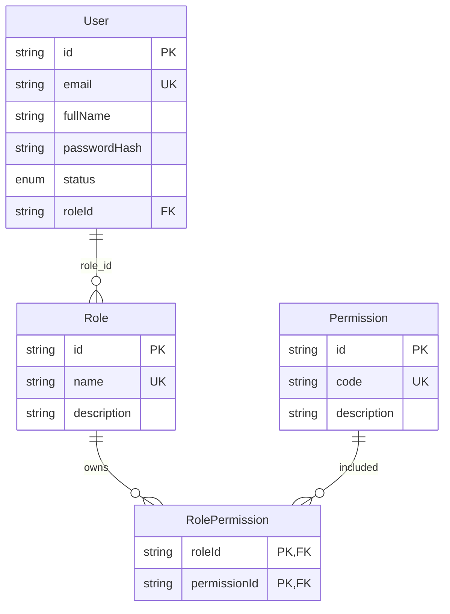
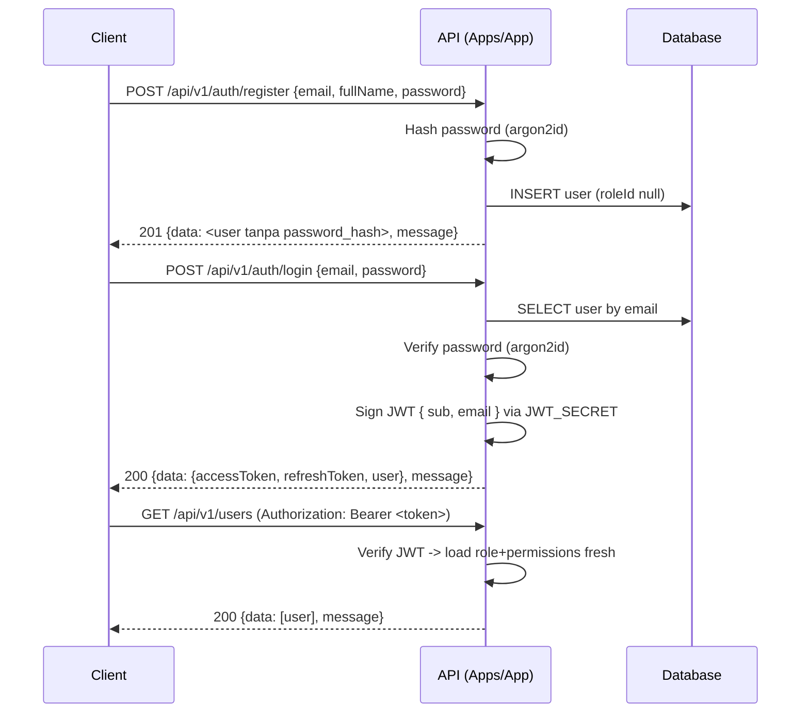

# RBAC — Role Based Access Control (Spec)

Menu: [user.md](./user.md) · [role.md](./role.md) · [permission.md](./permission.md) · [role-permissions.md](./role-permissions.md) · [api-key.md](./api-key.md)

---

## 1. Overview

Modul RBAC menyediakan dua kemampuan inti backend:

1. **Autentikasi (Auth)** — registrasi & login user, menerbitkan JWT.
2. **Otorisasi (Authorization)** — pembatasan akses endpoint berdasarkan role dan permission user.

Model domain (final, sudah dikonfirmasi user):

| Relasi | Keterangan |
| --- | --- |
| `user` 1 : N `role` | Satu user memiliki max satu role (FK `role_id` di `users`). |
| `role` N : M `permission` | Melalui tabel join `role_permissions`. |
| `permission` | Memiliki `code` unik berkonvensi `resource:action`. |

Prinsip:

- Satu user → satu role → banyak permission.
- Akses ditentukan oleh `permission.code` (`resource:action`) yang cocok dengan dekorator endpoint.
- Sumber kebenaran tunggal (single source of truth): role/permission selalu di-load **fresh dari DB** setiap request (lihat [Authorization](#6-authorization)).

---

## 2. ERD



Versi teks:

```
User 1 ── N Role  N ── M Permission
 │                 │
 │ role_id         └── Tabel join: role_permissions (role_id, permission_id)
```

---

## 3. Model Prisma (lengkap)

Lokasi sumber: `libs/prisma/schema.prisma` (satu-satunya sumber entity, lihat RULES bab 4).

```prisma
model User {
  id           String     @id @default(uuid())
  email        String     @unique
  fullName     String     @map("full_name")
  passwordHash String     @map("password_hash")
  status       UserStatus @default(ACTIVE)
  roleId       String?    @map("role_id")
  role         Role?      @relation(fields: [roleId], references: [id])
  createdAt    DateTime   @default(now()) @map("created_at")
  updatedAt    DateTime   @updatedAt @map("updated_at")

  @@map("users")
}

enum UserStatus {
  ACTIVE
  INACTIVE
  BLOCKED
}

model Role {
  id          String           @id @default(uuid())
  name        String           @unique
  description String?
  permissions RolePermission[]
  users       User[]
  createdAt   DateTime         @default(now()) @map("created_at")
  updatedAt   DateTime         @updatedAt @map("updated_at")

  @@map("roles")
}

model Permission {
  id          String           @id @default(uuid())
  code        String           @unique
  description String?
  roles       RolePermission[]
  createdAt   DateTime         @default(now()) @map("created_at")
  updatedAt   DateTime         @updatedAt @map("updated_at")

  @@map("permissions")
}

model RolePermission {
  roleId       String     @map("role_id")
  permissionId String     @map("permission_id")
  role         Role       @relation(fields: [roleId], references: [id], onDelete: Cascade)
  permission   Permission @relation(fields: [permissionId], references: [id], onDelete: Cascade)
  createdAt    DateTime   @default(now()) @map("created_at")

  @@id([roleId, permissionId])
  @@map("role_permissions")
}
```

Catatan konsistensi relasi:

- `RolePermission.permission` adalah **backfield** dari `Permission.roles`.
- `RolePermission.role` adalah **backfield** dari `Role.permissions`.
- `User.role` adalah backfield dari `Role.users`.
- `onDelete: Cascade` pada `RolePermission`: menghapus role/permission otomatis menghapus baris join-nya. `users.role_id` **tidak** memakai cascade — penghapusan role yang masih dipakai user ditolak di service (lihat keputusan di [role.md](./role.md#2-model-prisma)).

---

## 4. Konvensi Permission Code

Format: **lowercase** `resource:action`.

| Resource | Action | Code |
| --- | --- | --- |
| user | create | `user:create` |
| user | read | `user:read` |
| user | update | `user:update` |
| user | delete | `user:delete` |
| role | create | `role:create` |
| role | read | `role:read` |
| role | update | `role:update` |
| role | delete | `role:delete` |
| permission | create | `permission:create` |
| permission | read | `permission:read` |
| permission | update | `permission:update` |
| permission | delete | `permission:delete` |
| network | create | `network:create` |
| network | read | `network:read` |
| network | update | `network:update` |
| network | delete | `network:delete` |
| network | approve | `network:approve` (DRAFT\|REQUEST→PUBLISHED) |
| network | reject | `network:reject` (REQUEST→DRAFT) |
| network | unpublish | `network:unpublish` (PUBLISHED→DRAFT) |
| apikey | create | `apikey:create` |
| apikey | read | `apikey:read` |
| apikey | update | `apikey:update` |
| apikey | delete | `apikey:delete` |
| admin | access | `admin:access` (khusus gerbang manajemen user/role) |

Selain CRUD, resource konten (`story`, `event`, `archive`) memakai `action` tambahan berupa transisi workflow: `submit` (DRAFT→REQUEST), `approve` (DRAFT|REQUEST→PUBLISHED), `reject` (REQUEST→DRAFT), `publish` (DRAFT|APPROVED→PUBLISHED), `unpublish` (PUBLISHED→DRAFT) → mis. `story:submit`, `event:publish` (lihat [story.md §6](./story.md#action--transisi) & [event.md §7](./event.md#7-tabel-endpoint--permission)).

Aturan:

- Selalu lowercase, `:` pemisah `resource` dan `action`.
- `resource` = domain (tunggal), `action` ∈ `create | read | update | delete` (+ action workflow konten).
- Resource lain di luar RBAC (mis. `payment`, `order`) mengikuti pola yang sama saat ditambahkan.

---

## 5. Auth Flow



Detail:

- **Password**: di-hash dengan **argon2id** (mis. `@node-rs/argon2`) saat register. `passwordHash` tidak pernah diekspos keluar API (select selalu menyembunyikan kolom ini — lihat [user.md](./user.md#3-entity-payload-type)).
- **JWT**: sign dengan `JWT_SECRET` (dari `@nestjs/config`, via env — RULES bab 8). Payload `{ sub: userId, email }`, expiry dari `JWT_EXPIRES_IN`.
- **Refresh token**: mekanisme lengkap (rotasi, logout, blacklist Redis) di **[`auth.md`](./auth.md)**. Login mengembalikan `{ accessToken, refreshToken, user }`.

---

## 6. Authorization (deny-by-default)

Mekanisme kerja (global guard: `JwtAuthGuard` lalu `PermissionsGuard` via `APP_GUARD` — detail di RULES Bab 21):

```
JWT valid? (JwtAuthGuard global)
  ├─ @Public() → lolos penuh (tanpa JWT)
  ├─ NO  → 401 Unauthorized
  └─ YES → PermissionsGuard:
              ├─ @Permissions(...) cocok (fresh dari DB) → allow
              ├─ @Permissions(...) tak cocok → 403 Forbidden
              ├─ tanpa metadata + ada user → allow sebagai LOGIN-only
              │   (hanya POST /auth/logout & GET /auth/me yang sah)
              └─ tanpa metadata + tanpa user → 403 + Logger.warn (bug: dekorator lupa)
```

Komponen:

1. **`JwtAuthGuard`** (global, pertama) — memverifikasi JWT di header `Authorization: Bearer <token>` + cek blacklist Redis `jwt:blacklist:<jti>`. JWT tidak valid / expired / tidak ada → `401 Unauthorized`. `@Public()` mem-bypass guard ini.
2. **`@Public()`** — metadata `IS_PUBLIC_KEY`; dipakai endpoint publik (lihat daftar pengecualian di bawah).
3. **`@Permissions('user:read', ...)`** — dekorator metadata `PERMISSIONS_KEY`; permission yang dibutuhkan endpoint.
4. **`PermissionsGuard`** (global, kedua, deny-by-default) — mengecek `IS_PUBLIC_KEY` dulu, lalu `PERMISSIONS_KEY`; memuat user + role + daftar `permission.code` **fresh dari DB** (bukan dari klaim JWT) via `PermissionService.getPermissionCodesByUserId` lalu mencocokkan minimal satu code.

```typescript
// Struktur aktual PermissionsGuard (deny-by-default) — RULES Bab 21e
import { Injectable, CanActivate, ExecutionContext, ForbiddenException, UnauthorizedException, Logger } from '@nestjs/common';
import { Reflector } from '@nestjs/core';

@Injectable()
export class PermissionsGuard implements CanActivate {
  private readonly logger = new Logger(PermissionsGuard.name);

  constructor(
    private readonly reflector: Reflector,
    private readonly permissionService: PermissionService, // load fresh dari DB
  ) {}

  async canActivate(context: ExecutionContext): Promise<boolean> {
    // 1. PUBLIC → lolos penuh.
    const isPublic = this.reflector.getAllAndOverride<boolean>(IS_PUBLIC_KEY, [
      context.getHandler(),
      context.getClass(),
    ]);
    if (isPublic) return true;

    // 2. Ambil metadata permission endpoint.
    const required = this.reflector.getAllAndOverride<string[]>(PERMISSIONS_KEY, [
      context.getHandler(),
      context.getClass(),
    ]);

    const { user } = context.switchToHttp().getRequest();

    // 3. Deny-by-default: tanpa metadata = dekorator lupa → warn.
    //    Ada user → LOGIN-only (hanya logout/me yang sah); tanpa user → 403.
    if (!required || required.length === 0) {
      this.logger.warn(
        `Missing @Permissions metadata on ${context.getClass().name}.${context.getHandler().name} — Permission required`,
      );
      if (!user?.id) throw new ForbiddenException('Permission required');
      return true;
    }

    // 4. Metadata ada tapi tanpa user → 401.
    if (!user?.id) throw new UnauthorizedException('Unauthorized');

    // 5. Load fresh dari DB, cocokkan minimal satu code.
    const codes = await this.permissionService.getPermissionCodesByUserId(user.id);
    const allowed = required.some((code) => codes.includes(code));
    if (!allowed) throw new ForbiddenException('Forbidden resource');
    return true;
  }
}
```

Aturan urutan:

- `@Public()` → lolos kedua guard (tanpa JWT).
- JWT invalid / expired / blacklisted → **401** (JwtAuthGuard, didahulukan).
- JWT valid tapi permission kurang → **403** (PermissionsGuard).
- Tanpa metadata + ada user terautentikasi → lolos sebagai **LOGIN-only** — hanya sah untuk `POST /api/v1/auth/logout` dan `GET /api/v1/auth/me`.
- Tanpa metadata + tanpa user → **403** `ForbiddenException('Permission required')` + `Logger.warn` → **dianggap bug** (dekorator lupa), bukan alur normal. Larang mengandalkan pola ini untuk endpoint baru.

### Daftar pengecualian resmi

**PUBLIC** (`@Public()`):

| Method | Path | Keterangan |
| --- | --- | --- |
| GET | `/api/v1/health` | Health check. |
| POST | `/api/v1/auth/register` | Registrasi mandiri. |
| POST | `/api/v1/auth/login` | Login, terbit JWT. |
| POST | `/api/v1/auth/refresh` | Rotasi refresh token. |

**LOGIN-only** (tanpa dekorator, lolos karena `request.user` ada):

| Method | Path | Keterangan |
| --- | --- | --- |
| POST | `/api/v1/auth/logout` | Blacklist access + revoke refresh. |
| GET | `/api/v1/auth/me` | Profil user + role + permissions. |

Selain tabel di atas, **semua** endpoint users/roles/permissions **wajib** `@Permissions(...)` (lihat §8). Detail prinsip 401 vs 403 + konvensi `resource:action` ada di RULES Bab 21.

### Single source of truth (RULES bab 4)

Role & permission diambil **fresh** dari DB setiap request, bukan dari klaim JWT. Konsekuensi:

- Role baru / permission baru langsung berlaku tanpa user login ulang.
- Role dihapus/diubah → akses langsung menyesuaikan.
- Trade-off: 1 query ekstra per request — bisa dioptimalkan (lihat cache di bawah).

### Opsional: cache Redis (RULES bab 17)

Optimasi opsional untuk memangkas query per request:

| Aspek | Nilai |
| --- | --- |
| Key | `perm:user:<id>` |
| Value | `string[]` (`permission.code` milik user) |
| TTL | eksplisit, mis. 300 detik |
| Invalidasi | `del` saat mutasi role/permission/relasi role-permission |
| Larang | jangan cache payload sensitif (tidak ada di sini — hanya kode permission) |

Pola `cache miss → query DB → simpan → return`, error Redis diabaikan dan fallback ke DB (tidak lempar ke client, RULES bab 17).

```typescript
const key = `perm:user:${userId}`;
const cached = await this.cache.get<string[]>(key);
if (cached) return cached;
const codes = await this.permissionRepository.findCodesByUserId(userId);
await this.cache.set(key, codes, 300);
return codes;
```

---

## 7. Seed Default

Lokasi tunggal: `libs/prisma/seed.ts` (sumber deklaratif `DEFAULT_PERMISSIONS` / `DEFAULT_ROLES`, aturan lengkap di RULES Bab 22). Seed bersifat idempoten (aman diulang) dan additive.

| Konstanta | Isi |
| --- | --- |
| `DEFAULT_PERMISSIONS` | Array `{ code, description }` — 71 code: RBAC 12 (`user/role/permission` × `create/read/update/delete`), `story:*` 9, `category:*` 4, `event:*` 9, `event-type:*` 3 (`create,read,delete`), `city:*` 1 (`create`), `state:*` 1 (`create`), `network:*` 7 (`create,read,update,delete,approve,reject,unpublish`), `subscription:*` 4, `billing:*` 4, `subscription-request:*` 3 (`read,approve,reject`), `apikey:*` 4, `archive:*` 9, `admin:access` 1 (**khusus gerbang manajemen user/role; hanya `admin`**). Format lowercase `resource:action`. |
| `DEFAULT_ROLES` | Array `{ name, description, permissions: string[] }` — 3 role: `admin` (semua code), `member` (`story:read`, `story:create`, `story:update`, `story:submit`, `event:read`, `event:create`, `event:update`, `event:submit`, `event-type:read`, `city:create`, `state:create`, `category:read`, `archive:read`, `archive:create`, `archive:update`, `archive:submit`), `author` (permission set **sama persis** dengan `member`, berbagi konstanta `MEMBER_PERMISSION_CODES`). Struktur array siap tambah role baru. |
| User admin | Dari env `ADMIN_EMAIL` / `ADMIN_FULL_NAME` / `ADMIN_PASSWORD` → role `admin`, status `ACTIVE`. |

### Matriks role → permission

71 permission dibagi ke 3 role. `admin` = seluruh 71 code; `member` = 16 code; `author` = 16 code (sama dengan `member`).

| Resource | Code | admin | member | author |
| --- | --- | :---: | :---: | :---: |
| user | `user:create` | ✅ | — | — |
| user | `user:read` | ✅ | — | — |
| user | `user:update` | ✅ | — | — |
| user | `user:delete` | ✅ | — | — |
| role | `role:create/read/update/delete` (4) | ✅ | — | — |
| permission | `permission:create/read/update/delete` (4) | ✅ | — | — |
| story | `story:create` | ✅ | ✅ | ✅ |
| story | `story:read` | ✅ | ✅ | ✅ |
| story | `story:update` | ✅ | ✅ | ✅ |
| story | `story:delete` | ✅ | — | — |
| story | `story:submit` | ✅ | ✅ | ✅ |
| story | `story:approve` | ✅ | — | — |
| story | `story:reject` | ✅ | — | — |
| story | `story:publish` | ✅ | — | — |
| story | `story:unpublish` | ✅ | — | — |
| event | `event:create` | ✅ | ✅ | ✅ |
| event | `event:read` | ✅ | ✅ | ✅ |
| event | `event:update` | ✅ | ✅ | ✅ |
| event | `event:delete` | ✅ | — | — |
| event | `event:submit` | ✅ | ✅ | ✅ |
| event | `event:approve` | ✅ | — | — |
| event | `event:reject` | ✅ | — | — |
| event | `event:publish` | ✅ | — | — |
| event | `event:unpublish` | ✅ | — | — |
| event-type | `event-type:create` | ✅ | — | — |
| event-type | `event-type:read` | ✅ | ✅ | ✅ |
| event-type | `event-type:delete` | ✅ | — | — |
| category | `category:create` | ✅ | — | — |
| category | `category:read` | ✅ | ✅ | ✅ |
| city | `city:create` | ✅ | ✅ | ✅ |
| state | `state:create` | ✅ | ✅ | ✅ |
| category | `category:update` | ✅ | — | — |
| category | `category:delete` | ✅ | — | — |
| network | `network:create/read/update/delete/approve/reject/unpublish` (7) | ✅ | — | — |
| subscription | `subscription:create/read/update/delete` (4) | ✅ | — | — |
| billing | `billing:create/read/update/delete` (4) | ✅ | — | — |
| subscription-request | `subscription-request:read/approve/reject` (3) | ✅ | — | — |
| apikey | `apikey:create/read/update/delete` (4) | ✅ | — | — |
| archive | `archive:create` | ✅ | ✅ | ✅ |
| archive | `archive:read` | ✅ | ✅ | ✅ |
| archive | `archive:update` | ✅ | ✅ | ✅ |
| archive | `archive:delete` | ✅ | — | — |
| archive | `archive:submit` | ✅ | ✅ | ✅ |
| archive | `archive:approve` | ✅ | — | — |
| archive | `archive:reject` | ✅ | — | — |
| archive | `archive:publish` | ✅ | — | — |
| archive | `archive:unpublish` | ✅ | — | — |
| admin | `admin:access` | ✅ | — | — |

> `member` & `author` **tidak** boleh approve/reject/publish/unpublish — transisi maksimal sampai `REQUEST` (`submit`), untuk event **maupun story** miliknya sendiri. `author` identik dengan `member`. Row-level scoping (konten milik network/creator) dijelaskan di [§10](#10-row-level-scoping).


```typescript
// libs/prisma/seed.ts (ringkas) — deklaratif + upsert dalam satu $transaction
const DEFAULT_PERMISSIONS = [
  { code: 'user:create', description: 'Membuat user baru' },
  // ... 71 code: RBAC 12 + story 9 + category 4 + event 9 + event-type 3 + city 1 + state 1 + network 7 + subscription 4 + billing 4 + subscription-request 3 + apikey 4 + archive 9 + admin:access 1
];

// Permission set bersama `member` & `author` (identik, 16 code).
const MEMBER_PERMISSION_CODES = ['story:read', 'story:create', 'story:update', 'story:submit', 'event:read', 'event:create', 'event:update', 'event:submit', 'event-type:read', 'city:create', 'state:create', 'category:read', 'archive:read', 'archive:create', 'archive:update', 'archive:submit'];

const DEFAULT_ROLES = [
  { name: 'admin', description: 'Admin dengan akses penuh RBAC',
    permissions: DEFAULT_PERMISSIONS.map((p) => p.code) },
  { name: 'member', description: 'Anggota network — mengelola event & story sendiri (sampai REQUEST)',
    permissions: MEMBER_PERMISSION_CODES },
  { name: 'author', description: 'Author — mengelola event & story sendiri (sampai REQUEST)',
    permissions: MEMBER_PERMISSION_CODES },
];

// Role legacy yang sudah dihapus dari DEFAULT_ROLES (rename RBAC v2): dibersihkan targeted by name.
const LEGACY_ROLE_NAMES = ['organization'];

await prisma.$transaction(async (tx) => {
  for (const perm of DEFAULT_PERMISSIONS) {
    await tx.permission.upsert({
      where: { code: perm.code },
      update: { description: perm.description },
      create: { code: perm.code, description: perm.description },
    });
  }

  for (const role of DEFAULT_ROLES) {
    await tx.role.upsert({
      where: { name: role.name },
      update: { description: role.description },
      create: { name: role.name, description: role.description },
    });
  }

  // ADDITIVE: hanya tambah yang kurang.
  for (const role of DEFAULT_ROLES) {
    for (const code of role.permissions) {
      await tx.rolePermission.upsert({
        where: { roleId_permissionId: { roleId, permissionId } },
        update: {},
        create: { roleId, permissionId },
      });
    }
  }

  // Hapus role legacy (mis. `organization`): targeted by name; relasi role-permission ikut cascade.
  await tx.role.deleteMany({ where: { name: { in: LEGACY_ROLE_NAMES } } });

  // Password selalu di-reset dari env (re-hash argon2id) tiap re-seed.
  await tx.user.upsert({
    where: { email: ADMIN_EMAIL },
    update: { fullName: ADMIN_FULL_NAME, passwordHash, roleId: adminRoleId },
    create: { email: ADMIN_EMAIL, fullName: ADMIN_FULL_NAME, passwordHash, roleId: adminRoleId, status: 'ACTIVE' },
  });
});
```

Jalankan:

```bash
pnpm prisma:seed
```

Catatan:

- **Idempoten**: seed 2x tidak `P2002`; `description` ikut ter-update via `upsert`.
- **Additive**: permission baru yang ditambah ke `DEFAULT_PERMISSIONS` + `permissions` role otomatis ter-link ke role terkait tanpa menghapus relasi lama.
- **Role legacy**: `LEGACY_ROLE_NAMES` (`organization`) di-`deleteMany` targeted by name tiap seed → role lama hilang, relasi `role_permissions` ikut cascade, dan user yang masih memakainya → `roleId` NULL (`onDelete: SetNull`). Relasi role lain tidak tersentuh.
- **Permission legacy**: `LEGACY_PERMISSION_CODES` (9 code `archive/event/story-submission:*` + 4 code `network-submission:*` fitur usulan lama) di-`deleteMany` targeted by `code` tiap seed → permission basi hilang, relasi `role_permissions`/`api_key_permissions` ikut cascade; usulan network kini lewat `network:approve`/`network:reject`.
- **`admin:access`**: hanya `admin` (dari `DEFAULT_PERMISSIONS.map`). Gerbang `user.service` list/create/update/delete/assignRole; bukan permission konten.
- **Reset password**: tiap re-seed me-re-hash `ADMIN_PASSWORD` (argon2id) dan meng-update `passwordHash` user admin. Secret hanya dari env, tidak di-commit dan tidak di-log.

---

## 8. Ringkasan Endpoint

Semua path memakai prefix **`/api/v1`**. Semua respon sukses `{ data, message }`, error `{ statusCode, message, errors }` (RULES bab 5). Otorisasi deny-by-default (RULES Bab 21 + §6): setiap endpoint wajib `@Public()` | `@Permissions(...)` | LOGIN-only (hanya logout/me).

### Health

| Method | Path | Deskripsi | Akses |
| --- | --- | --- | --- |
| GET | `/api/v1/health` | Health check | PUBLIC (`@Public()`) |

### Auth (sinkron dengan [auth.md](./auth.md#7-endpoint) & [user.md](./user.md#7-endpoint))

| Method | Path | Deskripsi | Akses |
| --- | --- | --- | --- |
| POST | `/api/v1/auth/register` | Registrasi user baru | PUBLIC (`@Public()`) |
| POST | `/api/v1/auth/login` | Login, menerbitkan JWT | PUBLIC (`@Public()`) |
| POST | `/api/v1/auth/refresh` | Rotasi refresh token | PUBLIC (`@Public()`, body `refreshToken`) |
| POST | `/api/v1/auth/logout` | Logout, blacklist + revoke | LOGIN-only (tanpa dekorator, butuh Bearer) |
| GET | `/api/v1/auth/me` | Profil user + role + permissions | LOGIN-only (tanpa dekorator, butuh Bearer) |

### Users (sinkron dengan [user.md](./user.md#7-endpoint))

| Method | Path | Deskripsi | Akses |
| --- | --- | --- | --- |
| POST | `/api/v1/users` | Buat user oleh admin | PERMISSION: `user:create` |
| GET | `/api/v1/users` | List user | PERMISSION: `user:read` |
| GET | `/api/v1/users/:id` | Detail user | PERMISSION: `user:read` |
| PATCH | `/api/v1/users/:id` | Update user | PERMISSION: `user:update` |
| PATCH | `/api/v1/users/:id/role` | Ubah role user | PERMISSION: `user:update` |
| DELETE | `/api/v1/users/:id` | Hapus user | PERMISSION: `user:delete` |

> **Dua lapis:** guard `@Permissions('user:*')` (deny-by-default) **dan** gerbang eksplisit permission `admin:access` di `user.service` (list/create/findOne/update/delete/assignRole). Role custom dengan permission konten apa pun **tetap 403**.

### Roles (sinkron dengan [role.md](./role.md#7-endpoint))

| Method | Path | Deskripsi | Akses |
| --- | --- | --- | --- |
| POST | `/api/v1/roles` | Buat role | PERMISSION: `role:create` |
| GET | `/api/v1/roles` | List role | PERMISSION: `role:read` |
| GET | `/api/v1/roles/:id` | Detail role | PERMISSION: `role:read` |
| PATCH | `/api/v1/roles/:id` | Update role | PERMISSION: `role:update` |
| DELETE | `/api/v1/roles/:id` | Hapus role | PERMISSION: `role:delete` |

### Permissions (sinkron dengan [permission.md](./permission.md#7-endpoint))

| Method | Path | Deskripsi | Akses |
| --- | --- | --- | --- |
| POST | `/api/v1/permissions` | Buat permission | PERMISSION: `permission:create` |
| GET | `/api/v1/permissions` | List permission | PERMISSION: `permission:read` |
| GET | `/api/v1/permissions/:id` | Detail permission | PERMISSION: `permission:read` |
| PATCH | `/api/v1/permissions/:id` | Update permission | PERMISSION: `permission:update` |
| DELETE | `/api/v1/permissions/:id` | Hapus permission | PERMISSION: `permission:delete` |

### Role-Permissions (sinkron dengan [role-permissions.md](./role-permissions.md#7-endpoint))

| Method | Path | Deskripsi | Akses |
| --- | --- | --- | --- |
| PUT | `/api/v1/roles/:id/permissions` | Replace set permission role | PERMISSION: `permission:update` |
| GET | `/api/v1/roles/:id/permissions` | List permission milik role | PERMISSION: `permission:read` |

> Kedua endpoint `roles/:id/permissions` memakai permission **`permission:*` yang sudah ada** — bukan resource baru (`role-permission:*` tidak ada). `PUT` = `permission:update`, `GET` = `permission:read` (TETAP, sesuai controller).

### API Keys (sinkron dengan [api-key.md](./api-key.md#7-endpoint))

| Method | Path | Deskripsi | Akses |
| --- | --- | --- | --- |
| POST | `/api/v1/api-keys` | Buat API key (raw `key` tampil sekali) | PERMISSION: `apikey:create` |
| GET | `/api/v1/api-keys` | List API key (tanpa key/hash) | PERMISSION: `apikey:read` |
| GET | `/api/v1/api-keys/:id` | Detail API key | PERMISSION: `apikey:read` |
| PATCH | `/api/v1/api-keys/:id` | Update nama/permission API key | PERMISSION: `apikey:update` |
| DELETE | `/api/v1/api-keys/:id` | Hapus permanen (hard delete) | PERMISSION: `apikey:delete` |

> Akses data selain lewat JWT bisa memakai header **`x-api-key: <raw>`**; principal key membawa permission custom-nya sendiri. Modul lengkap: [api-key.md](./api-key.md).

### Story & Category (sinkron dengan [story.md](./story.md#11-tabel-endpoint-lengkap))

Modul `story` mengelola `Post` (resource backend `post`, label FE Story) + `Category`, upload gambar ke S3 lewat `POST /images`.

| Method | Path | Deskripsi | Akses |
| --- | --- | --- | --- |
| POST | `/api/v1/posts` | Buat story | PERMISSION: `story:create` |
| GET | `/api/v1/posts` | List story | PERMISSION: `story:read` |
| GET | `/api/v1/posts/:id` | Detail story | PERMISSION: `story:read` |
| PATCH | `/api/v1/posts/:id` | Update story | PERMISSION: `story:update` |
| DELETE | `/api/v1/posts/:id` | Hapus story (+ row `images` & objek S3) | PERMISSION: `story:delete` |
| POST | `/api/v1/posts/:id/submit` | Ajukan story review (`DRAFT`→`REQUEST`) | PERMISSION: `story:submit` |
| POST | `/api/v1/posts/:id/approve` | Setujui & terbitkan story (`DRAFT\|REQUEST`→`PUBLISHED`) | PERMISSION: `story:approve` |
| POST | `/api/v1/posts/:id/reject` | Tolak story (`REQUEST`→`DRAFT`) | PERMISSION: `story:reject` |
| POST | `/api/v1/posts/:id/publish` | Terbitkan story (`DRAFT\|APPROVED`→`PUBLISHED`) | PERMISSION: `story:publish` |
| POST | `/api/v1/posts/:id/unpublish` | Tarik story (`PUBLISHED`→`DRAFT`) | PERMISSION: `story:unpublish` |
| POST | `/api/v1/categories` | Buat kategori (idempoten) | PERMISSION: `category:create` |
| GET | `/api/v1/categories` | List kategori | PERMISSION: `category:read` |
| GET | `/api/v1/categories/:id` | Detail kategori | PERMISSION: `category:read` |
| PATCH | `/api/v1/categories/:id` | Update kategori | PERMISSION: `category:update` |
| DELETE | `/api/v1/categories/:id` | Hapus kategori | PERMISSION: `category:delete` |
| POST | `/api/v1/images` | Upload gambar ke S3 (multipart `file`) | PERMISSION: `story:create`, `story:update` (ANY-of) |

> Tidak ada endpoint `GET /uploads` maupun permission `image:*`; gambar disajikan langsung oleh S3/CDN via URL absolut.

> **Permission action story (`story:submit`, `story:approve`, `story:reject`, `story:publish`, `story:unpublish`) kini di-enforce** oleh endpoint `POST /api/v1/posts/:id/<action>` (lihat [story.md](./story.md#action--transisi)). Transisi status tak valid → **409**. `PATCH /api/v1/posts/:id` (`story:update`) tetap untuk update konten.
>
> ⚠️ **Bypass workflow ditutup untuk non-admin.** Hanya scope `all` (permission moderator) yang masih bisa memaksa `status`/`publishedAt` via `PATCH`/`POST`; untuk `network`/`own`/`published`, `create` dipaksa `status=DRAFT` (+ `publishedAt` dibuang) dan `update` mengabaikan `status`/`publishedAt` — **kecuali** pemilik (`network`/`own`) boleh mengirim `status: DRAFT` untuk menarik kontennya sendiri yang `PUBLISHED` kembali ke `DRAFT` (lihat [§10](#10-row-level-scoping)). Follow-up: hapus `status`/`publishedAt` dari DTO setelah FE migrasi ke endpoint action.
>
> Scope `all` saja **tidak cukup** untuk terbit via `PATCH`: `status: PUBLISHED` / `publishedAt` (string ISO) wajib `*:approve` **atau** `*:publish` → selain itu **403**. `publishedAt: null` = jangan sentuh (bukan epoch).

### Bulk Actions Konten (sinkron dengan [story.md](./story.md), [event.md](./event.md), [archive.md](./archive.md))

| Method | Path | Deskripsi | Akses |
| --- | --- | --- | --- |
| POST | `/api/v1/posts/bulk-status` | Bulk ubah status story (max 100 id, target `DRAFT\|REQUEST\|PUBLISHED`; `APPROVED` → 400) | PERMISSION: `story:update` **+** transisi per target (`story:approve` / `story:publish` / `story:reject` / `story:unpublish` / `story:submit`) |
| POST | `/api/v1/posts/bulk-delete` | Bulk hapus story (max 100 id) | PERMISSION: `story:delete` |
| POST | `/api/v1/events/bulk-status` | Bulk ubah status event (max 100 id, target `DRAFT\|REQUEST\|PUBLISHED`; `APPROVED` → 400) | PERMISSION: `event:update` **+** transisi per target (`event:approve` / `event:publish` / `event:reject` / `event:unpublish` / `event:submit`) |
| POST | `/api/v1/events/bulk-delete` | Bulk hapus event (max 100 id) | PERMISSION: `event:delete` |
| POST | `/api/v1/archives/bulk-status` | Bulk ubah status archive (max 100 id, target `DRAFT\|REQUEST\|PUBLISHED`; `APPROVED` → 400) | PERMISSION: `archive:update` **+** transisi per target (`archive:approve` / `archive:publish` / `archive:reject` / `archive:unpublish` / `archive:submit`) |
| POST | `/api/v1/archives/bulk-delete` | Bulk hapus archive (max 100 id) | PERMISSION: `archive:delete` |

> Respons bulk status `{ updated, skipped, failed }`; bulk delete `{ deleted, failed }`. Per-id lewat service `transition`/`remove` → aturan transisi & scope tetap berlaku.

### Network (sinkron dengan [network.md](./network.md))

| Method | Path | Deskripsi | Akses |
| --- | --- | --- | --- |
| POST | `/api/v1/networks` | Buat network | PERMISSION: `network:create` |
| GET | `/api/v1/networks` | List network | PERMISSION: `network:read` |
| GET | `/api/v1/networks/:id` | Detail network | PERMISSION: `network:read` |
| PATCH | `/api/v1/networks/:id` | Update network | PERMISSION: `network:update` |
| DELETE | `/api/v1/networks/:id` | Hapus network | PERMISSION: `network:delete` |
| POST | `/api/v1/networks/:id/approve` | Setujui usulan network (DRAFT\|REQUEST→PUBLISHED) | PERMISSION: `network:approve` |
| POST | `/api/v1/networks/:id/reject` | Tolak usulan network (REQUEST→DRAFT) | PERMISSION: `network:reject` |
| POST | `/api/v1/networks/:id/submit` | Ajukan network (DRAFT→REQUEST) | PERMISSION: `network:update` |
| POST | `/api/v1/networks/:id/unpublish` | Tarik network dari publikasi (PUBLISHED→DRAFT) | PERMISSION: `network:unpublish` |
| POST | `/api/v1/networks/bulk-status` | Bulk ubah status (max 100 id, target `DRAFT\|REQUEST\|PUBLISHED`) | PERMISSION: `network:update` **+** transisi per target (`network:approve` / `network:reject` / `network:unpublish`) |

> `submit` sengaja tetap memakai `network:update` (bukan `network:submit`) — mengajukan network = mengubahnya, dan belum ada code `network:submit` di `DEFAULT_PERMISSIONS`. `unpublish` memakai code sendiri (`network:unpublish`) agar `network:approve` tak bisa menghasilkan efek `reject`. Bulk `DRAFT` butuh `network:reject` **atau** `network:unpublish` (bukan `network:approve`); detail di [network.md §6](./network.md#6-endpoint--permission).

### Geographic Reference (sinkron dengan [country.md](./country.md), [region.md](./region.md) & [state.md](./state.md))

Data referensi geografis untuk dropdown pra-login → **PUBLIC**, tanpa RBAC.

| Method | Path | Deskripsi | Akses |
| --- | --- | --- | --- |
| GET | `/api/v1/regions` | List region (dropdown) | PUBLIC (`@Public()`) |
| GET | `/api/v1/countries` | List negara (dropdown, pagination) | PUBLIC (`@Public()`) |
| GET | `/api/v1/countries/:id` | Detail negara by `id` (Int) | PUBLIC (`@Public()`) |
| GET | `/api/v1/states` | List state/provinsi (dropdown, pagination, filter `countryId`/`countryCode` — `countryCode` uppercase ISO-2, case-sensitive) | PUBLIC (`@Public()`) |
| GET | `/api/v1/states/:id` | Detail state by `id` (Int), + `country` | PUBLIC (`@Public()`) |

### Stats (sinkron dengan RULES §21d)

| Method | Path | Deskripsi | Akses |
| --- | --- | --- | --- |
| GET | `/api/v1/stats/summary` | Ringkasan publik: event published, user aktif, jumlah negara (story/event/organization/member) | PUBLIC (`@Public()`) |

> `stats/summary` hanya menghitung konten `PUBLISHED` + `publishedAt <= now` + `visibility = PUBLIC` untuk story/event; `organization` (Network.country) & `member` (User.countryId) tetap semua.

---

## 9. Error Handling Umum

Mapping status sesuai RULES bab 13:

| Status | Makna | Contoh kemunculan |
| --- | --- | --- |
| 400 | Bad Request | body/query tidak dapat dipahami, payload tidak sesuai |
| 401 | Unauthorized | JWT tidak ada / invalid / expired; credential login salah |
| 403 | Forbidden | JWT valid tapi permission kurang |
| 404 | Not Found | resource (user/role/permission) tidak ditemukan |
| 409 | Conflict | `email`/`name`/`code` duplikat; hapus role yang masih dipakai user |
| 422 | Unprocessable Entity | validasi DTO gagal (`errors` berisi detail per-field) |
| 500 | Internal Server Error | error tak terduga |

Format respon:

```json
// sukses
{ "data": { "id": "550e8400-e29b-41d4-a716-446655440000", "email": "admin@mail.com" }, "message": "success" }

// error validasi
{
  "statusCode": 422,
  "message": "Validation failed",
  "errors": [{ "field": "password", "message": "password must be longer than or equal to 8 characters" }]
}

// error umum
{ "statusCode": 404, "message": "User not found", "errors": [] }
```

Detail exception per endpoint ada di tiap file module: [user.md](./user.md#8-error--exception) · [role.md](./role.md#8-error--exception) · [permission.md](./permission.md#8-error--exception) · [role-permissions.md](./role-permissions.md#8-error--exception).

---

## 10. Row-Level Scoping

Selain RBAC (permission per endpoint), konten `Post`/`Event` dibatasi **per baris** berdasarkan permission + organisasi/creator pemilik. Sumber tunggal: `AccessScopeService.resolve(userId, resource)` → `libs/src/core/auth/access-scope.service.ts` (provider global `LibsModule`). `User`/`Role`/`Permission` **tidak** memakai scoping ini — gerbang manajemen user/role = permission eksplisit `admin:access` (lihat §7).

### Resolusi scope

Penentuan scope **berbasis permission** (`role.permissions[].code`) + `networkId`, **per-resource** (`resolve(userId, resource)` dengan `resource ∈ {'story','event'}`) — **tidak** memakai `role.code`/nama role, dan **bukan** penentu hak manajemen user/role (lihat `admin:access` di §7).

```typescript
export type ContentResource = 'story' | 'event';
export const CONTENT_MODERATOR_ACTIONS = ['approve', 'publish', 'reject', 'unpublish'] as const; // M6
export const CONTENT_WRITE_ACTIONS = ['create', 'update', 'submit'] as const;

export type AccessScope =
  | { kind: 'all'; canViewPrivate: boolean; isMember: boolean }                   // status-manager konten (resource ini)
  | { kind: 'network'; networkId: string; userId: string; canViewPrivate: boolean; isMember: boolean }
  | { kind: 'own'; userId: string; canViewPrivate: boolean; isMember: boolean }   // penulis konten tanpa organisasi
  | { kind: 'published'; canViewPrivate: boolean; isMember: boolean }
  | { kind: 'none'; canViewPrivate: boolean; isMember: boolean };

async resolve(userId: string, resource: ContentResource): Promise<AccessScope> {
  const codes = /* role.permissions[].code milik user */;
  const canViewPrivate = canViewPrivateFromCodes(codes); // hanya tulis/status-manager (H1)
  const isMember = await this.billingService.hasActiveMembership(userId); // billing PAID + belum kedaluwarsa
  const isWriter = hasActions(codes, resource, CONTENT_WRITE_ACTIONS); // M2: per-resource
  if (hasActions(codes, resource, CONTENT_MODERATOR_ACTIONS)) return { kind: 'all', canViewPrivate, isMember };
  if (user?.networkId && isWriter)
    return { kind: 'network', networkId: user.networkId, userId, canViewPrivate, isMember };
  if (isWriter) return { kind: 'own', userId, canViewPrivate, isMember };
  return { kind: 'published', canViewPrivate, isMember };
}
```

| `kind` | Pemicu (permission, bukan nama role) | Arti |
| --- | --- | --- |
| `all` | salah satu `<resource>:approve\|publish\|reject\|unpublish` untuk resource terkait | Tanpa pembatasan baris. |
| `network` | punya `networkId` **dan** permission tulis resource terkait (`<resource>` × `create`/`update`/`submit`) | Hanya konten yang `creator.networkId === networkId`. Dipicu hanya oleh role custom (lihat catatan di bawah). |
| `own` | permission tulis resource terkait **tanpa** `networkId` | Baca: konten miliknya **atau** konten terbit (M5). Tulis: hanya konten miliknya. |
| `published` | selain di atas | Baca hanya konten **yang sudah terbit**: `status = PUBLISHED` **dan** `publishedAt != null` **dan** `publishedAt <= now`; tanpa `canViewPrivate`/`isMember` baris `PRIVATE` disembunyikan (`visibility = PUBLIC`). Tidak punya hak tulis. Scheduled publish (publishedAt di masa depan) belum terlihat. |
| `none` | — | Tidak boleh apa-apa (dipertahankan untuk kompatibilitas; saat ini tak terpicu). |

`canViewPrivate` (boolean, **independen** dari `kind`) = punya permission **tulis** (`create`/`update`/`submit`) atau **status** (`approve`/`publish`/`reject`/`unpublish`) pada `story`/`event`/`archive` — **bukan** sekadar `*:read` (H1). `admin`/`member`/`author` punya tulis konten → tetap `true`; role custom read-only → `false`.

`isMember` (boolean, **independen** dari `kind`) = **membership aktif** = `Billing.status = PAID` **dan** `Billing.expiryDate > now` (dihitung `BillingService.hasActiveMembership(userId)`, fresh per request).

**Visibilitas member-only** = `canViewPrivate || isMember`. Baca konten `Post`/`Event` `visibility = PRIVATE` dan `Archive.type = MEMBER` diizinkan bila salah satu `true`; keduanya `false` → baris disembunyikan (list) / **403** (findOne) / payload diredaksi (archive `externalLinks`/`documents`). `canViewPrivate`/`isMember` **hanya** memperluas **baca** — `isWriter` dan write guard tetap permission/ownership, tidak berubah.

> Scope **ortogonal** dengan permission: guard RBAC tetap jalan lebih dulu. Scoping hanya mempersempit baris yang boleh diakses setelah permission lolos. Role `published` (member) memang tak punya permission tulis, scoping hanya jaring pengaman tambahan.
>
> Sejak role bawaan `organization` dihapus (RBAC v2), **tidak ada role default yang memicu scope `network`**. Jalur ini hanya aktif untuk **role custom** yang diberi permission tulis resource (`story:create/update/submit` atau `event:create/update/submit`) **dan** user-nya punya `networkId`.

### Baca (`list`)

Scope digabung (AND) ke filter list:

| `kind` | Perlakuan `list` |
| --- | --- |
| `all` | Tanpa tambahan. |
| `network` | `{ creator: { networkId } }` (post/event) / `{ networkId }` (user) di-`AND` dengan filter. |
| `own` | `OR: [{ createdBy: userId }, <published-visible>]` (M5) di-`AND` dengan filter. |
| `published` | `{ status: PUBLISHED, publishedAt: { not: null, lte: now } }` di-`AND` dengan filter; **non-reader** (`!(canViewPrivate \|\| isMember)`) ditambah `{ visibility: PUBLIC }`. Scheduled publish (masa depan) tak ikut. |
| `none` | **List kosong** `{ items: [], total: 0 }` (bukan 403). |

Parenthesis: scope hanya berlaku untuk `Post`/`Event` (di-`AND` ke `filterWhere`). `User` **tidak** memakai `AccessScope` lagi — `user.service` murni digerbang permission `admin:access`; `Role`/`Permission` memakai `@Permissions('role:*'/'permission:*')` (tanpa `AccessScope`).

### Baca (`findOne`) — 403 vs list kosong

| `kind` | `findOne` |
| --- | --- |
| `all` | Bebas. |
| `network` | `creator.networkId !== scope.networkId` → **403** `ForbiddenException('Forbidden resource')`. |
| `own` | `createdBy !== scope.userId` **dan** baris bukan konten terbit → **403** (M5). |
| `published` | `status !== PUBLISHED` **atau** `publishedAt == null` **atau** `publishedAt > now` → **403**; baris `visibility = PRIVATE` dan tanpa `canViewPrivate`/`isMember` → **403**. |
| `none` | **403**. |

Kontras: `list` menyembunyikan baris (hasil kosong), `findOne` menolak eksplisit dengan **403**.

### Tulis (`create`/`update`/`remove`/`transition`)

| `kind` | Perlakuan |
| --- | --- |
| `all` | Bebas. |
| `network` | `create` diizinkan (konten baru milik creator di network-nya); `update`/`remove`/`transition` hanya bila baris `creator.networkId === scope.networkId`, selain itu **403**. |
| `own` | `create` diizinkan (konten baru milik `createdBy = userId`); `update`/`remove`/`transition` hanya bila baris `createdBy === scope.userId`, selain itu **403**. |
| `published` | **403** (defensif; guard permission umumnya sudah memblok lebih dulu). |
| `none` | **403**. |

> **Pengecualian:** purge cascade hapus user (`DELETE /users/:id?cascadeContent=true`) memanggil `*.service.remove(id, userId, { skipScopeCheck: true })` sehingga tabel ini dilewati. Operasi itu sudah diotorisasi `user:delete` + `admin:access`; scope konten yang lebih sempit akan membuat purge berhenti separuh jalan (tidak ada rollback lintas service). Lihat [`user.md`](./user.md#delete-user--cascade-konten-opsional). Tanpa opsi, `remove` tetap menegakkan scope seperti tabel di atas.

### Bypass workflow ditutup

Untuk scope `!= all`, field `status`/`publishedAt` dari body **diabaikan**, kecuali satu kasus: pemilik (`network`/`own`) boleh menarik kontennya sendiri yang berstatus `PUBLISHED` kembali ke `DRAFT` ("save as draft").

- `create` → paksa `status = DRAFT`, `publishedAt = undefined` (dan `approvedAt` tidak diisi).
- `update` → blok `status`/`publishedAt` dilewati; hanya konten yang berubah. **Kecuali**: baris miliknya (`creator.networkId === scope.networkId` untuk `network`, `createdBy === userId` untuk `own`) berstatus `PUBLISHED` dan body mengirim `status: DRAFT` → `status` di-set `DRAFT`; `publishedAt`/`approvedAt` **dipertahankan** (konsisten transisi `unpublish`). Nilai `status` lain (`REQUEST`/`APPROVED`/`PUBLISHED`) dan `publishedAt` tetap diabaikan.

Akibatnya role tanpa permission status-manager (`member`/`author`, serta role custom apa pun yang hanya punya permission tulis) tidak bisa memaksa `PUBLISHED`/`APPROVED` lewat `POST`/`PATCH` — harus lewat endpoint action (`story:publish`/`event:publish`, yang tidak dimilikinya). Scope `all` (status-manager) tetap bisa (backward-compat FE).

### Cakupan

| Domain | Scoping | Catatan |
| --- | --- | --- |
| `Post` (`post.service.ts`) | ✅ | `resolve(userId, 'story')`; `creator.networkId`; list/findOne/create/update/remove/transition. |
| `Event` (`event.service.ts`) | ✅ | `resolve(userId, 'event')`; idem post. |
| `User` (`user.service.ts`) | ✗ (ganti) | **Tidak** pakai `AccessScope`; gerbang permission eksplisit `admin:access` untuk list/findOne/create/update/delete/assignRole. |
| `Role`/`Permission` | ✗ | Gerbang `@Permissions('role:*'/'permission:*')`; tanpa `AccessScope`. |
| `Network` | ✗ | Admin-only via permission `network:*`; tanpa scoping baris. |
| `Category` | ✗ | Taksonomi global; `member`/`author` hanya punya `category:read`. |
